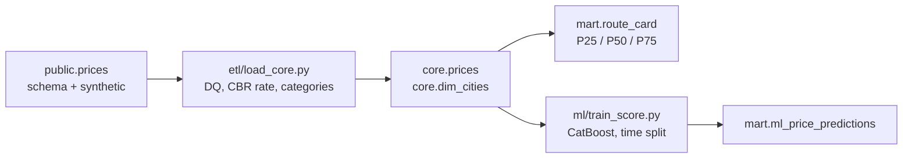
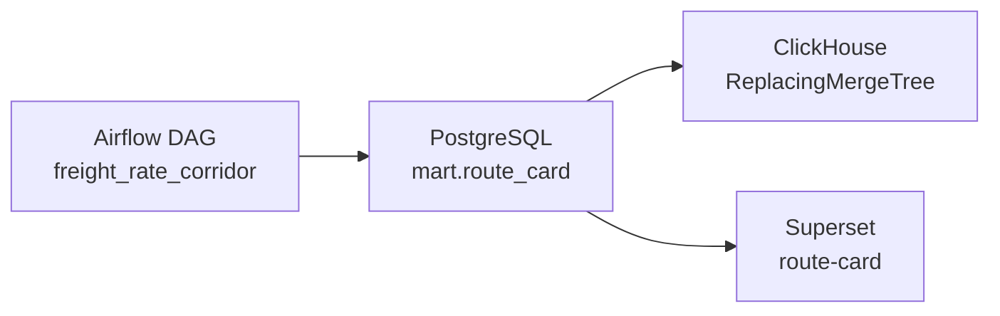

# Freight rate corridor

[Русская версия](README.ru.md)

Take-home for the Smart Logistics rate desk. Closed deals go in. A monthly route card and a batch tariff forecast come out.

## What I built

PostgreSQL 17 holds the data. Python does the cleaning rules and the model, because those are the parts I want under pytest. The route card is one SQL statement: quartiles, MoM and YoY are much harder to get wrong in SQL than in a dataframe, and 300k rows do not need a second engine.

Airflow, Superset and ClickHouse sit on the bonus profile. They republish the same mart, so the numbers do not move. `docker-compose up` is still Postgres and one pipeline run.

CatBoost is the model that gets written to `mart.ml_price_predictions`. A shallow decision tree is fit on the same split and stored next to it in `mart.ml_run_metrics`, so there is something boring to compare against.



## Layout

| Path | What it is |
| --- | --- |
| `assignment/` | Original brief, attachments, and the source SQL |
| `sql/dwh/` | `core` and `mart` DDL |
| `sql/mart/route_card.sql` | The corridor query |
| `sql/ml/dataset.sql` | Rows the model is allowed to read |
| `sql/checks.sql` | Queries I use after a run |
| `etl/` | DQ, city dedup, idempotent load, mart refresh |
| `ml/` | Features, time split, train, batch score |
| `pipeline.py` | One entrypoint for all three stages |
| `dags/`, `sql/clickhouse/`, `docker/airflow/`, `docker/superset/` | Bonus profile: Airflow DAG, ClickHouse copy, Superset dashboard |
| `tests/` | Rules, split, leakage, optional DB rerun |

## Run

```bash
docker-compose up --build
```

On an empty volume Postgres loads the schema and the synthetic generator (300 000 deals, `setseed(0.20261026)`). That step is the slow one. The pipeline container waits for `public.source_ready`. `pg_isready` goes green earlier, while init is still inserting, so the healthcheck looks at the marker.

When the pipeline container exits, Postgres stays up. From the host:

```bash
psql -h localhost -p 5433 -U postgres -d deals_bigdata
```

Password is `postgres` (local container only, see `.env.example`). Nothing in the Python code has a password baked in.

Run it again. Core, the card and the predictions are replaced, not appended:

```bash
docker-compose run --rm pipeline
```

Reload one `loading_date` window. That slice of `core.prices` and `core.dq_quarantine_prices` is deleted and copied back. The card and the model are then rebuilt from whatever is in core. MoM needs the previous month, and the train window is fixed, so a mart-only refresh of September would be the wrong grain.

```bash
docker-compose run --rm pipeline python pipeline.py --start 2026-09-01 --end 2026-09-30
```

`--only etl`, `--only mart` or `--only ml` if you only want one stage.

Tests do not need a database:

```bash
python -m venv .venv
.venv/bin/pip install -r requirements.txt
.venv/bin/pytest
```

Against a loaded database, this reloads September twice and checks that counts and sums stay put:

```bash
RUN_DB_TESTS=1 .venv/bin/pytest tests/test_idempotency.py
```

Generate the snapshot from scratch:

```bash
docker-compose down -v
docker-compose up --build
```

`N_PRICES` is read only on the first init. Changing it later does nothing until the volume is removed.

## Bonus profile

Airflow, Superset and ClickHouse are the starred track. `docker-compose up` does not start them.

```bash
docker-compose --profile bonus up --build clickhouse clickhouse-sync bonus-db airflow superset
```

Name the services. A bare `--profile bonus up` also starts `pipeline`, and that trains CatBoost again. The command above leaves the pipeline container alone and uses the mart already in Postgres. On a brand-new volume, run `docker-compose up --build` first and wait until the pipeline container exits.

These processes talk to the Compose Postgres, not to Supabase. `POSTGRES_PASSWORD` has to be the password that volume was created with.

| Service | URL | Local login |
| --- | --- | --- |
| Airflow | http://localhost:8080 | `admin` / `admin` |
| Superset | http://localhost:8088 | `admin` / `admin`, dashboard `route-card` |
| ClickHouse | http://localhost:8123 | user `default`, password `corridor` |

The DAG `freight_rate_corridor` is paused on creation. Unpause it for the next rebuild. Four tasks: `etl`, then `route_card`, then `score` and `clickhouse` together. `score` is the same CatBoost job as `pipeline.py`. `clickhouse` copies `mart.route_card` into a `ReplacingMergeTree` ordered by the card's primary key. A second run inserts again; `OPTIMIZE ... FINAL` leaves one row per cell. The copy checks `count(*)` and `sum(trips_count)` against Postgres and exits if they differ.

Superset reads that Postgres mart. The dashboard has the model metrics, the Moscow → Rostov-on-Don tent FTL median, and the monthly rows behind it.



After the copy, the same lane in ClickHouse:

```bash
docker compose exec clickhouse clickhouse-client --password corridor --query "
SELECT price_month, trips_count, median_trip
FROM mart.route_card FINAL
WHERE loading_city_gcid = 1001
  AND unloading_city_gcid = 1008
  AND body_group = 'Тент'
  AND weight_category = 'FTL'
ORDER BY price_month
"
```

Logins and the Fernet key above are the local defaults in `docker-compose.yml`. Override them from `.env.example`.

## Cleaning

The ETL window is `loading_date`, both ends inclusive. Default is 2019-01-01 through 2027-12-31, which is the whole snapshot including planned loads after the cut-off.

Rejected rows land in `core.dq_quarantine_prices` with one reason. First match wins, otherwise the counts are impossible to add up:

1. `non_positive_price` — `price <= 0`
2. `rub_price_below_floor` — RUB and `price <= 1000`. A few hundred rubles is not a trip. The floor is RUB only, because USD/EUR amounts are already in the hundreds.
3. `bad_distance` — `distance <= 0`
4. `negative_weight` / `negative_volume` — strictly `< 0`. Zero weight and zero volume stay.
5. `unknown_city` — origin or destination `gc_id` is not in `cities`
6. `unknown_currency`
7. `missing_fx_rate` — USD (`840`) or EUR (`978`) with no `exchange_rates` row on the exact `nearest_rate_date`

Same city on both ends is not a reason. The source job stores the pair and the distance, and the brief says not to invent that rule.

RUB uses rate 1. Foreign currency uses the CBR rate whose `setting_date` equals `nearest_rate_date`. Upstream, that date is the last fixing on or before `created_at` (or the earliest later one), not the loading date. If the column is null, or it points at a day with no fixing, the row is quarantined. I do not search again by `loading_date`.

Weight and volume categories are filled only where the source left them blank. Weight is rounded to 0.1 t with half-away-from-zero, same as `round(numeric, 1)`, then:

| Tons | Category |
| --- | --- |
| >= 30 | G20T |
| [10, 30) | FTL |
| [5, 10) | 10T |
| [2.5, 5) | 5T |
| [0.5, 2.5) | L5T |
| otherwise | OTH |

Volume is `FTL` for `(0, 120]` m³ and `OTH` otherwise. So 0 m³ is OTH and 120 m³ is still FTL.

`outlier_mark` is copied and not recomputed. The card and the model both drop `outlier_mark = true`. A second IQR pass is allowed by the brief and is not a substitute for the flag, so I did not add one.

Deals created on the snapshot day, 2026-10-26, have not been through the night outlier job. Their flag stays false even when the price is nonsense. Those rows can enter the October corridor and the test week. That is a property of the extract. Relabelling them in the loader would hide it.

`price_group_id` is not selected into core. `price_group_stats` is an aggregate of the raw price and can include the deal you are about to score.

Cities are deduped to the smallest `cities.id` per `gc_id`. Moscow (`1001`) and Kazan (`1003`) both have a second row; joining the raw table would double trips. The region is the text after the first comma on the surviving row, so Kazan keeps `Республика Татарстан` and not the later spelling `Татарстан`.

## Route card

`mart.route_card`. Grain is month × origin × destination × body group × weight category.

The month is `date_trunc('month', price_dates.price_date)`. A long order is a data point in every month the source expanded it into. Using only `loading_date` would drop those later months. `volume_category` is not part of the grain: one cell mixes FTL and OTH volume, and picking a mode would look cleaner than the data is.

Body group comes from `price_body_types` when the link exists, otherwise from `prices.body_type`, otherwise `Не указан`.

| Codes | Group |
| --- | --- |
| 56–61 | Тент |
| 4, 46, 47, 48 | Рефрижератор |
| 2 | Изотерм |
| 1, 15 | Борт |
| anything else | Прочие |
| null | Не указан |

A parent code and its child in the same group collapse to one row. Tent plus board stays two cells: the same price is a real observation in both corridors.

A deal is in the card when it is a fact, not complex, `price > 0`, `price_rub > 0`, `distance > 0`, the outlier flag is off, and `price_date <= 2026-10-26`. Auction rows (`price_type = 6`) can sit in core and do not enter the card. Planned months after the snapshot do not either. The model has its own rule for future loads, based on `loading_date`.

Per cell, in RUB without VAT:

- trip corridor: `p25_trip`, `median_trip`, `p75_trip`, `avg_trip`
- per km: `p25_km`, `median_km`, `p75_km` of `price_rub / distance`
- `trips_count` — distinct deals (a deal is counted once per month per body group)
- `carriers_count` — distinct `organization_id` with `price_type in (3, 9)`
- `cv_rate` — `stddev_samp(price_rub) / avg(price_rub)`, null below two trips or when the average is 0
- `mom_pct`, `yoy_pct` — change in the median versus the previous calendar month, and versus the same month a year earlier. A missing neighbour is null. I do not substitute the last month that happens to exist.
- `reliability_level` — `HIGH` when trips ≥ 30, carriers ≥ 5, and the latest trip in that cell is at most 30 days before `as_of`. `MEDIUM` when trips ≥ 10. Otherwise `LOW_DATA`.

Freshness is about the cell you are looking at. A busy January does not become HIGH because the direction traded again in October. That row is not a live quote.

## Model

Target is `price_rub`. Population is factual, direct, positive price and distance, outlier flag off.

The cut-off is the snapshot, not the day you start the container:

- train: loading date in `[2026-07-26, 2026-10-05)`
- test: `[2026-10-05, 2026-10-26]`
- the 5th of October is test only
- no shuffle

Future loads (`loading_date > 2026-10-26`) are scored. `actual_price_rub`, `abs_error_rub` and `ape_pct` are null on those rows even when the snapshot already has a price. That price was not a completed trip on the cut-off date.

Features:

- distance, weight, volume
- origin city, origin region, origin lat/lon
- destination city, destination region, destination lat/lon
- body group, the body code stored on the price, weight category, volume category
- year, and sin/cos of month (`T = 12`), weekday (`T = 7`, Monday = 0) and day of year (`T = 365.25`)

City and region are separate columns. A glued `A → B` string is mostly unique pairs and the model memorises them.

One row per price. The card may count the same price under two body groups; the model uses `prices.body_type`, and only if that is null the smallest linked 1C code.

Left out on purpose: the price itself, price with VAT, rub per km, rub per ton, margin identities (`carrier_cost = customer_cost - profit`), `outlier_mark` as a feature, and every column of `price_group_stats`. The flag is only a filter. The group stats are built from the raw price and can contain the row being predicted.

Customer, forwarder and carrier facts are all in the train set (`price_type` 1, 2, 3, 4, 5, 9). The generator prices carrier rows a bit lower than customer rows, so the model learns a blended rate. That is what the brief asks to train on. I did not quietly restrict the sample to `price_type in (3, 9)`.

The tree's `OrdinalEncoder` is fit on train and applied to test with unknown categories as -1. CatBoost gets the categories as strings and is not scaled. `RANDOM_SEED` defaults to 42. A negative prediction is clipped to 0, because it is not a quote. Both models are clipped the same way before the metrics.

### Quality on the 300 000-deal snapshot

Train 24 226 rows, test 12 808, future loads scored on top of that: 4 888. CatBoost is ahead of the tree, not by a dramatic margin. Distance took about 62% of the CatBoost importance. The generator builds the tariff off kilometres, so that share is higher than the ~40% in the R&D note. MAPE 15.5% sits next to their ~13% guide. 26 October is still inside the test window and was not outlier-screened.

| Model | Rows (train / test) | R² | MAPE | RMSE, RUB | MAE, RUB |
| --- | ---: | ---: | ---: | ---: | ---: |
| decision tree | 24226 / 12808 | 0.9063 | 16.09% | 58 549 | 30 223 |
| CatBoost | 24226 / 12808 | 0.9191 | 15.48% | 54 428 | 27 936 |

The load quarantined 203 rows: 164 with `price <= 0`, 39 foreign rows with no fixing on `nearest_rate_date`. The route card came out at 203 644 cells. 10 of them are `HIGH`, 924 are `MEDIUM`, the rest are `LOW_DATA`. The grain is fine (month × city pair × body × weight), so a thin cell is the common case and the flag is doing what procurement asked. The thick ones are the obvious Moscow outbound FTL lanes. October Москва → Ростов-на-Дону, tent, FTL: 112 trips, 39 carriers, median about 127 000 RUB.

The same numbers are in `mart.ml_run_metrics` and `ml/artifacts/metrics.json` after a run.

## Queries

`sql/checks.sql` has the rest. The card I open first:

```sql
select price_month,
       trips_count,
       carriers_count,
       reliability_level,
       round(p25_trip::numeric)  as p25_trip,
       round(median_trip::numeric) as median_trip,
       round(p75_trip::numeric) as p75_trip,
       round(mom_pct::numeric, 1) as mom_pct
from mart.route_card
where loading_city_gcid = 1001
  and unloading_city_gcid = 1003
  and body_group = 'Тент'
  and weight_category = 'FTL'
order by price_month;
```

Fact against forecast, worst relative misses on the test window:

```sql
select price_id, loading_date, body_group,
       round(actual_price_rub::numeric) as actual,
       round(predicted_price_rub::numeric) as predicted,
       round(ape_pct::numeric, 1) as ape_pct
from mart.ml_price_predictions
where actual_price_rub is not null
order by ape_pct desc
limit 20;
```

## Left out on purpose

- No second outlier detector. The supplied flag is the filter.
- No FX lookup by loading date.
- Auction rows are cleaned into core and kept out of the card and the model.
