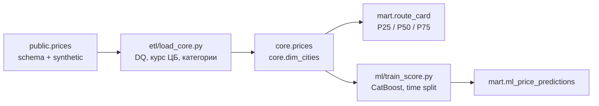
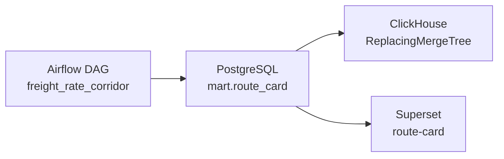

# Коридор ставок грузоперевозок

[English version](README.md)

Тестовое для сервиса ставок «Умной Логистики». На входе закрытые сделки, на выходе месячная карточка маршрута и пакетный прогноз тарифа.

## Что сделано

Данные лежат в PostgreSQL 17. Правила очистки и модель написаны на Python: их удобно закрыть pytest. Карточка маршрута — один SQL-запрос. Квартили, MoM и YoY в датафрейме проще испортить, а на 300 тысячах строк второй движок не нужен.

Airflow, Superset и ClickHouse вынесены в профиль `bonus`. Они публикуют ту же витрину, поэтому цифры не меняются. `docker-compose up` по-прежнему поднимает только Postgres и один прогон пайплайна.

В `mart.ml_price_predictions` пишется CatBoost. Рядом, на том же разбиении, обучается неглубокое дерево, и его метрики ложатся в `mart.ml_run_metrics`. Нужна была простая точка сравнения.



## Состав

| Путь | Что это |
| --- | --- |
| `assignment/` | Исходное задание, вложения и SQL источника |
| `sql/dwh/` | DDL слоёв `core` и `mart` |
| `sql/mart/route_card.sql` | Запрос коридора |
| `sql/ml/dataset.sql` | Строки, которые модели можно читать |
| `sql/checks.sql` | Запросы, которыми я проверяю прогон |
| `etl/` | DQ, дедуп городов, идемпотентная загрузка, пересчёт витрины |
| `ml/` | Признаки, временное разбиение, обучение, пакетный скоринг |
| `pipeline.py` | Одна точка входа на все три этапа |
| `dags/`, `sql/clickhouse/`, `docker/airflow/`, `docker/superset/` | Профиль `bonus`: DAG Airflow, копия в ClickHouse, дашборд Superset |
| `tests/` | Правила, разбиение, утечки, по желанию повторный прогон в БД |

## Запуск

```bash
docker-compose up --build
```

На пустом томе Postgres сначала грузит схему и синтетический генератор (300 000 сделок, `setseed(0.20261026)`). Это самая долгая часть. Контейнер пайплайна ждёт таблицу `public.source_ready`. `pg_isready` зеленеет раньше, пока init ещё вставляет строки, поэтому healthcheck смотрит на маркер.

Когда контейнер пайплайна завершается, Postgres остаётся поднят. С хоста:

```bash
psql -h localhost -p 5433 -U postgres -d deals_bigdata
```

Пароль `postgres` (только локальный контейнер, см. `.env.example`). В Python пароль не зашит.

Повторный запуск не дописывает строки, а заменяет core, карточку и прогнозы:

```bash
docker-compose run --rm pipeline
```

Перезагрузка одного окна `loading_date`. Этот срез удаляется из `core.prices` и `core.dq_quarantine_prices` и копируется заново. Карточка и модель потом собираются из того, что сейчас лежит в core. MoM нужен предыдущий месяц, окно обучения фиксировано, поэтому пересчитывать витрину только за сентябрь было бы неверным зерном.

```bash
docker-compose run --rm pipeline python pipeline.py --start 2026-09-01 --end 2026-09-30
```

`--only etl`, `--only mart` или `--only ml`, если нужен один этап.

Тесты без базы:

```bash
python -m venv .venv
.venv/bin/pip install -r requirements.txt
.venv/bin/pytest
```

На уже загруженной базе сентябрь прогоняется дважды, и проверяется, что количества и суммы не разъехались:

```bash
RUN_DB_TESTS=1 .venv/bin/pytest tests/test_idempotency.py
```

Собрать снимок заново:

```bash
docker-compose down -v
docker-compose up --build
```

`N_PRICES` читается только при первой инициализации. Потом его смена ничего не делает, пока не удалён том.

## Профиль bonus

Airflow, Superset и ClickHouse — задачи со звёздочкой. `docker-compose up` их не поднимает.

```bash
docker-compose --profile bonus up --build clickhouse clickhouse-sync bonus-db airflow superset
```

Сервисы нужно назвать явно. Голый `--profile bonus up` заодно стартует `pipeline`, и CatBoost обучается ещё раз. Команда выше пайплайн не трогает и берёт витрину, которая уже лежит в Postgres. На пустом томе сначала `docker-compose up --build` и дождаться, пока контейнер пайплайна завершится.

Эти процессы ходят в Postgres из Compose, не в Supabase. `POSTGRES_PASSWORD` должен быть тем паролем, с которым создавался том.

| Сервис | Адрес | Локальный вход |
| --- | --- | --- |
| Airflow | http://localhost:8080 | `admin` / `admin` |
| Superset | http://localhost:8088 | `admin` / `admin`, дашборд `route-card` |
| ClickHouse | http://localhost:8123 | пользователь `default`, пароль `corridor` |

DAG `freight_rate_corridor` создаётся на паузе. Снимите паузу, когда нужен следующий пересчёт. Четыре задачи: `etl`, затем `route_card`, затем вместе `score` и `clickhouse`. `score` — тот же прогон CatBoost, что и `pipeline.py`. `clickhouse` копирует `mart.route_card` в `ReplacingMergeTree` с тем же ключом, что и первичный ключ карточки. Повторный прогон вставляет строки снова; `OPTIMIZE ... FINAL` оставляет одну строку на ячейку. Копия сверяет `count(*)` и `sum(trips_count)` с Postgres и падает, если они разошлись.

Superset читает эту витрину в Postgres. На дашборде метрики модели, медиана Москва → Ростов-на-Дону, тент, FTL, и помесячные строки под ней.



Та же полоса в ClickHouse после копирования:

```bash
docker compose exec clickhouse clickhouse-client --password corridor --query "
SELECT price_month, trips_count, median_trip
FROM mart.route_card FINAL
WHERE loading_city_gcid = 1001
  AND unloading_city_gcid = 1008
  AND body_group = 'Тент'
  AND weight_category = 'FTL'
ORDER BY price_month
"
```

Логины и ключ Fernet выше — локальные значения по умолчанию из `docker-compose.yml`. Их можно переопределить через `.env.example`.

## Очистка

Окно ETL — `loading_date`, обе границы включительно. По умолчанию с 2019-01-01 по 2027-12-31: весь снимок, включая плановые погрузки после даты среза.

Отбракованные строки попадают в `core.dq_quarantine_prices` с одной причиной. Берётся первое совпадение, иначе статистику отсева не сложить:

1. `non_positive_price` — `price <= 0`
2. `rub_price_below_floor` — рубли и `price <= 1000`. Несколько сотен рублей — это не рейс. Порог только для RUB: суммы в USD/EUR и так измеряются сотнями.
3. `bad_distance` — `distance <= 0`
4. `negative_weight` / `negative_volume` — строго `< 0`. Нулевой вес и нулевой объём остаются.
5. `unknown_city` — `gc_id` отправления или назначения нет в `cities`
6. `unknown_currency`
7. `missing_fx_rate` — USD (`840`) или EUR (`978`) без строки `exchange_rates` ровно на `nearest_rate_date`

Одинаковый город на обоих концах причиной не считается. Исходный джоб такую пару и расстояние сохраняет, а в задании сказано это правило не выдумывать.

Для рублей курс равен 1. Для валюты берётся курс ЦБ, у которого `setting_date` совпадает с `nearest_rate_date`. Выше по потоку эта дата — последняя фиксация не позже `created_at` (или самая ранняя из более поздних), а не дата погрузки. Если поле пустое или на этот день фиксации нет, строка уходит в карантин. Повторный поиск по `loading_date` я не делаю.

Весовая и объёмная категории заполняются только там, где источник оставил пусто. Вес округляется до 0,1 т от нуля в сторону большего модуля, как `round(numeric, 1)`, и дальше:

| Тонны | Категория |
| --- | --- |
| >= 30 | G20T |
| [10, 30) | FTL |
| [5, 10) | 10T |
| [2.5, 5) | 5T |
| [0.5, 2.5) | L5T |
| иначе | OTH |

Объём: `FTL` при `(0, 120]` м³, иначе `OTH`. Ноль кубометров — это OTH, 120 м³ ещё FTL.

`outlier_mark` копируется и не пересчитывается. И карточка, и модель выкидывают `outlier_mark = true`. Второй проход по IQR заданием разрешён, но флаг он не заменяет, поэтому я его не добавлял.

Сделки, созданные в день снимка, 2026-10-26, ночной джоб аномалий ещё не размечал. Флаг у них остаётся false, даже если цена бессмысленная. Такие строки могут попасть в октябрьский коридор и в тестовую неделю. Это свойство выгрузки. Если переразметить их в загрузчике, ограничение спрячется.

`price_group_id` в core не выбирается. `price_group_stats` — агрегат по сырой цене, и в него может входить как раз та сделка, которую мы собираемся оценивать.

Города схлопываются до минимального `cities.id` на `gc_id`. У Москвы (`1001`) и Казани (`1003`) есть вторая строка; джойн к сырому справочнику удвоил бы рейсы. Регион — текст после первой запятой в оставшейся строке, поэтому у Казани остаётся `Республика Татарстан`, а не позднее написание `Татарстан`.

## Карточка маршрута

`mart.route_card`. Зерно: месяц × отправление × назначение × группа кузова × весовая категория.

Месяц — это `date_trunc('month', price_dates.price_date)`. Длинная заявка считается в каждом месяце, в который источник её развернул. Если брать только `loading_date`, поздние месяцы пропадут. `volume_category` в зерно не входит: в одной ячейке смешаны FTL и OTH по объёму, и одна мода выглядела бы точнее, чем данные.

Группа кузова берётся из `price_body_types`, если связь есть, иначе из `prices.body_type`, иначе `Не указан`.

| Коды | Группа |
| --- | --- |
| 56–61 | Тент |
| 4, 46, 47, 48 | Рефрижератор |
| 2 | Изотерм |
| 1, 15 | Борт |
| остальные | Прочие |
| null | Не указан |

Родительский код и дочерний из одной группы схлопываются в одну строку. Тент плюс борт остаются двумя ячейками: одна и та же цена — наблюдение в обоих коридорах.

В карточку попадает факт, не составной маршрут, `price > 0`, `price_rub > 0`, `distance > 0`, флаг выброса выключен и `price_date <= 2026-10-26`. Аукционные строки (`price_type = 6`) могут лежать в core и в карточку не входят. Плановые месяцы после снимка тоже. У модели для будущих погрузок своё правило, по `loading_date`.

По ячейке, в рублях без НДС:

- коридор за рейс: `p25_trip`, `median_trip`, `p75_trip`, `avg_trip`
- за километр: `p25_km`, `median_km`, `p75_km` от `price_rub / distance`
- `trips_count` — число разных сделок (сделка считается один раз на месяц и группу кузова)
- `carriers_count` — число разных `organization_id` при `price_type in (3, 9)`
- `cv_rate` — `stddev_samp(price_rub) / avg(price_rub)`, null, если рейсов меньше двух или среднее равно нулю
- `mom_pct`, `yoy_pct` — изменение медианы к предыдущему календарному месяцу и к тому же месяцу год назад. Если соседней ячейки нет, значение null. Последний «какой нашёлся» месяц я не подставляю.
- `reliability_level` — `HIGH`, если рейсов ≥ 30, перевозчиков ≥ 5 и последний рейс в этой ячейке не старше 30 дней относительно `as_of`. `MEDIUM`, если рейсов ≥ 10. Иначе `LOW_DATA`.

Свежесть относится к той ячейке, на которую смотришь. Загруженный январь не становится HIGH оттого, что направление снова торговалось в октябре. Эта строка — не живая котировка.

## Модель

Таргет — `price_rub`. В выборке фактические прямые рейсы с положительными ценой и расстоянием и выключенным флагом выброса.

Срез — дата снимка, а не день запуска контейнера:

- train: дата погрузки в `[2026-07-26, 2026-10-05)`
- test: `[2026-10-05, 2026-10-26]`
- 5 октября входит только в test
- перемешивания нет

Будущие погрузки (`loading_date > 2026-10-26`) оцениваются. На этих строках `actual_price_rub`, `abs_error_rub` и `ape_pct` равны null, даже если в снимке цена уже заполнена. На дату среза это ещё не состоявшийся рейс.

Признаки:

- расстояние, вес, объём
- город, регион и координаты отправления
- город, регион и координаты назначения
- группа кузова, код кузова с самой сделки, весовая и объёмная категории
- год и sin/cos месяца (`T = 12`), дня недели (`T = 7`, понедельник = 0) и дня года (`T = 365.25`)

Город и регион — отдельные колонки. Склеенная строка `A → B` почти сплошь уникальные пары, и модель их запоминает.

Одна строка на цену. Карточка может посчитать ту же цену в двух группах кузова; модель берёт `prices.body_type`, а если его нет — минимальный связанный код из 1С.

Намеренно не входят: сама цена, цена с НДС, рубль на километр, рубль на тонну, тождества маржи (`carrier_cost = customer_cost - profit`), `outlier_mark` как признак и все колонки `price_group_stats`. Флаг — только фильтр. Групповая статистика считается по сырой цене и может содержать предсказываемую строку.

В обучении вместе факты заказчика, экспедитора и перевозчика (`price_type` 1, 2, 3, 4, 5, 9). Генератор ставит перевозчику цену чуть ниже, чем заказчику, поэтому модель учит смешанную ставку. Так и сказано в задании. До `price_type in (3, 9)` я выборку молча не сужал.

`OrdinalEncoder` дерева учится на train и применяется к test, неизвестные категории получают -1. CatBoost получает категории строками и без масштабирования. `RANDOM_SEED` по умолчанию 42. Отрицательный прогноз обрезается до нуля: это не котировка. Перед метриками оба прогноза обрезаются одинаково.

### Качество на снимке в 300 000 сделок

Train — 24 226 строк, test — 12 808, сверху оценены будущие погрузки: 4 888. CatBoost лучше дерева, но не с большим отрывом. На расстояние пришлось около 62% важности CatBoost. Генератор строит тариф от километража, поэтому доля выше, чем ~40% в R&D-записке. MAPE 15,5% рядом с их ориентиром ~13%. 26 октября входит в тест и ночным джобом выбросов не размечено.

| Модель | Строки (train / test) | R² | MAPE | RMSE, руб. | MAE, руб. |
| --- | ---: | ---: | ---: | ---: | ---: |
| decision tree | 24226 / 12808 | 0.9063 | 16.09% | 58 549 | 30 223 |
| CatBoost | 24226 / 12808 | 0.9191 | 15.48% | 54 428 | 27 936 |

В карантин ушло 203 строки: 164 с `price <= 0` и 39 валютных без фиксации на `nearest_rate_date`. Карточка получилась на 203 644 ячейки. Из них 10 — `HIGH`, 924 — `MEDIUM`, остальные `LOW_DATA`. Зерно мелкое (месяц × пара городов × кузов × вес), поэтому тонкая ячейка — обычный случай, и флаг делает то, что просили закупки. Плотные ячейки — очевидные исходящие FTL из Москвы. Октябрь, Москва → Ростов-на-Дону, тент, FTL: 112 рейсов, 39 перевозчиков, медиана около 127 000 руб.

Те же числа после прогона лежат в `mart.ml_run_metrics` и в `ml/artifacts/metrics.json`.

## Запросы

Остальное в `sql/checks.sql`. Карточку я открываю первой:

```sql
select price_month,
       trips_count,
       carriers_count,
       reliability_level,
       round(p25_trip::numeric)  as p25_trip,
       round(median_trip::numeric) as median_trip,
       round(p75_trip::numeric) as p75_trip,
       round(mom_pct::numeric, 1) as mom_pct
from mart.route_card
where loading_city_gcid = 1001
  and unloading_city_gcid = 1003
  and body_group = 'Тент'
  and weight_category = 'FTL'
order by price_month;
```

Факт против прогноза, худшие относительные промахи на тестовом окне:

```sql
select price_id, loading_date, body_group,
       round(actual_price_rub::numeric) as actual,
       round(predicted_price_rub::numeric) as predicted,
       round(ape_pct::numeric, 1) as ape_pct
from mart.ml_price_predictions
where actual_price_rub is not null
order by ape_pct desc
limit 20;
```

## Что оставлено специально

- Второго детектора выбросов нет. Фильтр — переданный флаг.
- Курса по дате погрузки нет.
- Аукционные строки чистятся в core и не попадают ни в карточку, ни в модель.
